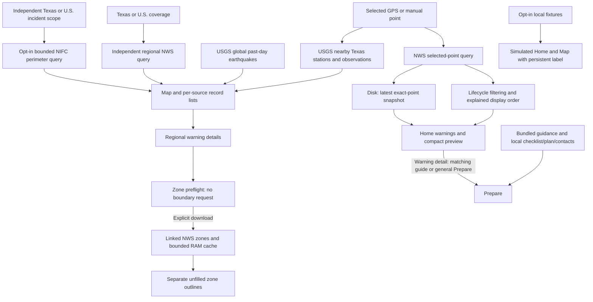

# Architecture

ClearPath uses Expo Router for navigation, TypeScript for data boundaries, TanStack Query for independent feed requests, and AsyncStorage for selected local state. Fresh installs open in live mode with no selected point and an unverified local result. Demo scenarios require an explicit choice. Version 1.1.0 includes the explainable ordering policy described below; executed checks and device-test scope are in [TESTING.md](TESTING.md). Team roles and development tools are documented in [STUDENT_CONTRIBUTIONS.md](STUDENT_CONTRIBUTIONS.md).

## Responsibilities

| Area | Responsibility |
| --- | --- |
| `src/app/` | Home, Map, Prepare routes and screen orchestration |
| `src/components/` | Warning/source details, native map, SVG coordinate fallback, manual zone viewer and sharing review |
| `src/ui/` | Design tokens and accessible shared presentation |
| `src/domain/types.ts` | App domain models; distinguish provenance and freshness |
| `src/data/` | Point/regional NWS adapters, exact-point disk snapshot, bundled guidance/fixtures |
| `src/domain/` | Validation, identity, update, and expiration helpers |
| `src/services/` | Foreground GPS/manual points, official USGS adapters, bounded NIFC perimeters and linked NWS zone loader |
| `src/state/` and `src/hooks/` | Mode/point, feed preferences, independent query observers, freshness/cancellation and local preparation saves |
| `src/student/priority.ts` | Pure warning display ordering and source-aware explanations |
| Tests | Unit/component coverage; see TESTING.md for actual locations and results |

The display policy is implemented. Road-closure data is not integrated; official road information is available through external reference links.

## Information flow

Wire responses are untrusted. Adapters retain source text, validate identity/timestamps/coordinates/geometry, and produce typed models. Each path owns its errors and retrieval time; observations also retain actual source/event times and units. UI receives these models rather than traversing raw responses.

## Decisions and boundaries

- Location permission is requested in the foreground following a deliberate action. A GPS point is explicitly a single reading. Canceling the pending request restores manual/city controls; late results are ignored. Manual selection keeps the app useful when permission is denied. A selected city's coordinates represent its selected point, not every resident in that city.
- Home's point observer is shared across tabs. Map independently queries Texas/U.S. regional NWS warnings, worldwide past-24-hour earthquakes, and up to 12 nearest Texas stream stations within 50 km of the selected point. The regional/earthquake overview needs no selected point; rivers do. Regional membership cannot replace Home's point result or establish personal applicability.
- Query identity includes the point, coverage, or feed window as appropriate. Obsolete/disabled/background/offline work is canceled, and late results cannot replace the current selection. Map polling additionally requires focus and an enabled layer.
- A snapshot's original retrieval time never advances through restoration or a failed refresh. Independent live/cached/unavailable labels, expiration and observation-age checks remain active even when automatic requests are off.
- Observation details retain the source and copy times captured at selection. Cached-at-open details cannot be promoted by reconnecting; live selections must still match the current layer's copy and record. Earthquake feed status/count are validated against raw features before display filtering, with generation and retrieval labeled separately.
- Simulated scenarios use an independent source path and never enter the real-data cache. Their coordinates, timestamps, warnings, and geometry are fictional presentation fixtures.
- Home identifies pending saved-point restoration separately from a missing point and keeps location selection usable. The last selected point restores in live mode; saved GPS is explicitly a previous selection, not a new reading. A newer deliberate location/demo choice wins over delayed hydration. Queued selection writes snapshot coordinates, skip obsolete work, and serialize in-flight work so the latest point is written last; stale/unmounted write failures cannot replace current feedback. Selecting a GPS/manual point exits demo without refreshing GPS in the background.
- Prepare opens on bundled field guides. Six controls reach guides, kit, plan, contacts, numbers and verified official Frisco/regional links. A bounded event-name map routes supported warning details to an existing guide; unknown events open general Prepare. A request identity reopens repeated guide requests without discarding form drafts. Navigation triggers no call or content download. One confirmed 911 action stays outside scrolling tabs, alongside source/demo status. Full-screen modals retain close controls.
- Home uses `prioritizeWarnings` with exact-point endpoint evidence and the provider's shared display clock. It retains all current warnings and original source objects. Map's regional list never inherits selected-point priority explanations. No combined physical-risk score is generated.
- Shared disclosures collapse secondary settings/coverage notes only. Home operational GPS and preference diagnostics remain mounted outside them. Source/freshness/error states and official instructions stay accessible.
- Warnings lacking supplied polygons remain listed. Native maps and the schematic SVG coordinate view draw only supplied warning geometry plus independently sourced event/station symbols; they do not derive flood extent, road passability or a safe route.
- The coordinate warning target groups all supplied parts and dateline copies into one action. Each part retains a separate filled path and its own holes, preserving overlap under evenodd painting. This changes accessibility targets rather than geometry; physical native grouping still needs verification.
- Linked zone viewing begins with a no-fetch preflight. An explicit download accepts up to four exact official endpoints under size/geometry limits. Its separate unfilled administrative outlines and cached timestamps never replace warning geometry or its mapped-warning count. Warning identity/issuance/zones, verified source, focus, connectivity and expiry gate the viewer; close/background/context changes abort it. Zone definitions also have independent effective/expiration checks. See DATA_SOURCES.md for limits.

## Update policy and storage

The automatic/manual feed preference is persisted separately and hydrated before feeds can start. Automatic is the fresh default; an unreadable preference fails to manual for that session. Manual mode stops automatic initial/resume requests, polling and NWS retry loops. Each explicit refresh remains a single logical attempt, gated by foreground/connectivity, selection/layer availability, cadence and provider Retry-After. It does not start background monitoring. Zone downloads remain explicit in either mode. Request deadlines live in RAM with the QueryClient, so observer remounts retain cadence. NWS point/regional Retry-After pauses share their provider; earthquake and river pauses remain separate. Old refresh callbacks cannot regain permission after a committed context change, and waiting requests recheck context and deadlines before downloading.

With automatic updates enabled, point/regional weather and earthquakes poll at 60 seconds; rivers and enabled wildfire perimeters at five minutes. NWS requests have a 30-second minimum gate; regional coverage switches share their gate. Automatic NWS transient failures have at most two retries with 30/60-second minimum backoff. USGS/NIFC have no automatic retry loop. Weather/earthquake verification ages at 90 seconds and river/perimeter copies at ten minutes, with separate event/observation/capture clocks. These are request/display policies, not emergency-delivery guarantees.

| Storage boundary | Contents |
| --- | --- |
| Bundled app assets | General safety guidance, kit references, demo fixtures and local fonts |
| AsyncStorage | Last selected point, one latest exact-point Home NWS snapshot, preparation/checklist/plan/contacts, automatic/manual preference |
| RAM only | Regional NWS/USGS/NIFC query snapshots, river discovery metadata, bounded linked-zone cache with original timestamps and less-than-24-hour validity |

Regional/USGS/NIFC/zone copies do not promise availability after a killed/reopened app. Restored Home copies remain cached and exact-point isolated. AsyncStorage is not encrypted, and no movement history is saved. Preparation has `loading`, `saving`, `saved` and `session` states. Successful hydration does not rewrite unchanged data; edited writes serialize, and only the latest revision can change save status/error. Unreadable preparation is protected from overwrite while session-only edits remain usable. A later edit or explicit **Retry local save** can recover a normal write failure without changing the values; duplicate retry presses are claimed synchronously. Read failures never enable that action.

## Explainable display policy

`src/student/priority.ts` accepts immutable normalized records, a valid selected point, explicit time, source and applicability evidence. It rejects mixed demo/official identifiers. Lifecycle resolution precedes ordinal urgency → severity → certainty ordering, then newest issuance and stable identity/source ties. Unknown fields remain visible and are explicitly not low danger. Equal-identity/time conflicts use deterministic source-field selection and disclose the ambiguity. The function returns original alerts plus source-aware reasons; it performs no network, GPS, storage or wall-clock reads. Supplied geometry does not replace NWS point membership, and missing geometry cannot discard a point warning. See its 41 tests and Home integration cases.

Actual/Public records issued more than 60 seconds ahead make a fresh NWS collection unverifiable before replacement/cancellation. Cached display filters implausible issuance before resolving references. Future onset is valid and separate. Point/regional observers reject negative snapshot age and schedule admission, retrieval and expiry boundaries so manual feeds recover after clock rollback without fetching or rewriting timestamps.

The fifth, fictional Frisco demo uses an independent public reference point and two `demo:frisco-*` warnings. Its fixed clock is not a historical claim; it omits the legacy Hunt river fixture. Leaving demo restores the user's live point and cache. No source route or notification path treats its fixtures as official.

## Remaining boundaries

USGS observations cannot alter official NWS classifications; gage height is not flood depth or an inferred flood-stage threshold. DriveTexas remains an external link; shelter occupancy and evacuation orders are not integrated. Optional NIFC published perimeters have independent incident coverage, bounded partial copies, exact unfilled outlines and separate capture/edit/retrieval times. They use RAM, start off, and never change NWS counts or enter demo. Their five-minute foreground request gate and ten-minute fetched-copy labeling do not establish a current fire edge. Map includes labeled tile failures and a coordinate fallback. Successful native tiles, current physical rendering and complete later milestones are not claimed; executed checks remain in TESTING.md.
