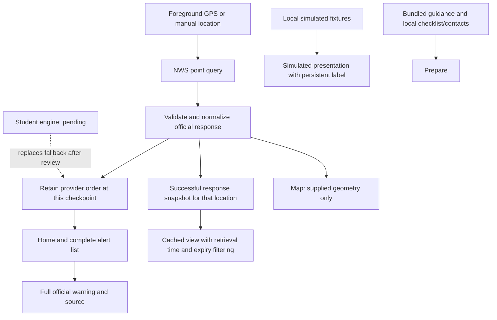

# Architecture

ClearPath uses Expo Router for native navigation, strict TypeScript for data boundaries, TanStack Query for asynchronous requests, and AsyncStorage for local state. Weather information stays independent from optional map, river, and road services so an optional failure cannot block the warning display.

## Responsibilities

| Area | Responsibility |
| --- | --- |
| `src/app/` | Home, Map, Prepare routes and warning details; navigation only |
| `src/components/` | Shared accessible controls, warning presentation, map view/fallback |
| `src/ui/` | Design tokens and accessible shared presentation |
| `src/domain/types.ts` | App domain models; distinguish provenance and freshness |
| `src/data/` | NWS network boundary, snapshots, bundled references/fixtures |
| `src/domain/` | Validation, identity, update, and expiration helpers |
| `src/services/location.ts` | City points, coordinate validation, foreground GPS |
| `src/state/` and `src/hooks/` | Shared mode, selected point, query observer, connectivity, local preparation |
| `src/student/` | Reserved original student relevance/prioritization work |
| Tests | Unit/component coverage; see TESTING.md for actual locations and results |

`src/student/` is a reserved contribution boundary; the original engine is pending. USGS discovery/observation and approved road adapters will be added in milestone 6, after student milestone 5.

## Information flow

The wire response is untrusted data. The adapter retains official text and enum values, validates coordinates/timestamps/geometry, and produces an app model. UI components receive the app model rather than traversing a raw API response.

## Decisions and boundaries

- Location permission is requested in the foreground following a deliberate action. Manual selection keeps the app useful when permission is denied. A selected city's coordinates represent its selected point, not every resident in that city.
- Query keys must include location, and a canceled/obsolete request must not overwrite a newer selection. The polling controller must operate only while relevant app activity is in the foreground.
- Each snapshot records its selected point and successful retrieval time. It cannot stand in for another location. Rehydrating a snapshot cannot update its retrieval time or establish current verification.
- Simulated scenarios use an independent source path and never enter the real-data cache. Their coordinates, timestamps, warnings, and geometry are fictional presentation fixtures.
- A fresh installation defaults to the labeled Flood scenario; returning to live mode requires a selected point before NWS retrieval. Selecting a GPS/manual point also exits demo. The single last selected point is stored locally and restored in live mode on later launches; restored GPS is explicitly a saved selection, not a current reading. One shared alert observer serves the tabs.
- Provider order is retained at this checkpoint; no combined priority score is generated. The first result must not be claimed to be a personalized highest-priority result. Keep every applicable warning accessible.
- An alert lacking a polygon can still apply through the NWS point endpoint. Map geometry is optional and cannot independently invalidate such a warning.
- Preparedness content is compiled into the app; completing a checklist changes only local state. AsyncStorage is not encrypted secret storage. Contacts should be limited to user-entered name/number data and deletable locally.

The current foreground NWS schedule is 60 seconds. A selected point cannot start another request within 30 seconds of its previous request; Retry-After can extend that gate. Network/timeout/429/5xx failures have at most two retries with a 30/60-second minimum delay. A previously successful response is presented as cached after a failed verification, lost connection, or 90 seconds without a new successful retrieval. Expiration has its own clock boundary. These intervals are display/network policies, not a promise of continuous emergency monitoring.

## Milestone 5 design boundary

The student owns how to express relevance, resolve updated messages, and organize multiple valid warnings with explanations. Accept official severity/urgency as facts; keep confidence about geography explicit. No numerical personal-risk probability or route safety is derived. The proposed test contract is in STUDENT_CONTRIBUTIONS.md, and it must be implemented and reviewed before replacing the fallback.

## Later integrations

USGS discovery and observations will be separate query paths with their own timestamps, errors, and units. Observations cannot alter official NWS classifications. DriveTexas remains an official external-resource link unless approval and terms authorize an adapter. Map/provider configuration must degrade gracefully when credentials or native capabilities are unavailable.
