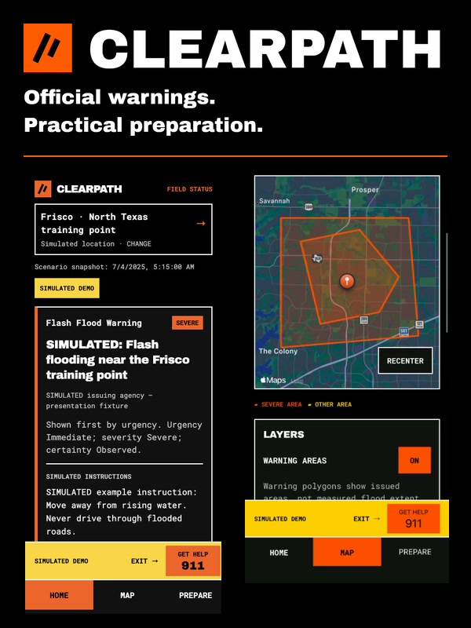

# ClearPath

**Official warnings. Practical preparation.**

A 2026 Congressional App Challenge project by **Manas and Shiven**.

ClearPath helps Texas families connect official weather warnings with emergency preparation. It brings selected-location warnings, regional hazard information, preparedness guides, an emergency kit checklist, family plans and contacts into one app.

**[Demo walkthrough](DEMO.md)** · **[App source](src/)** · **[Architecture](ARCHITECTURE.md)** · **[Tests](tests/)**



## What to review

- **Home:** official National Weather Service warnings for a selected point, original instructions, source timestamps and explanations of warning display order.
- **Map:** regional weather warnings, USGS earthquakes and nearby Texas river observations, with separate source and freshness information.
- **Prepare:** bundled safety guides, a locally saved emergency kit checklist, family meeting plans, contacts and official local resources.
- **Demo:** a fictional North Texas flood scenario for exploring the app without waiting for a real warning.

## Run the project

Use **Node.js 22** and npm. This repository contains source version **1.1.0**, built with **TypeScript, React Native, Expo SDK 57 and Expo Router**.

```sh
git clone https://github.com/lostden/clearpath.git
cd clearpath
npm ci --ignore-scripts
npm run web
```

The browser preview supports the warning and preparedness workflows and a labeled schematic map. No account, GPS permission or API key is needed for the simulated demo. Native basemaps are available in the mobile app.

For iOS or Android, run `npm start -- --lan` and open the current QR code using an Expo Go client compatible with SDK 57 on the same reachable Wi-Fi network. Keep the development server running. The repository does not include a standalone 1.1.0 app binary; older Android previews are earlier versions.

## A short review path

1. On **Home**, scroll to **Training demo** and choose **Explore simulated demo**. The **North Texas flood** scenario opens with visible **SIMULATED DEMO** labels.
2. Open **Read simulated warning**, inspect **Why this warning is shown here**, then choose **Read Flooding guide**.
3. Open **Map** to inspect the fictional warning areas and source details.
4. Open **Prepare** to try **Kit**, **Family Plan** and **Contacts**. Use fictional information when testing saved fields.

See the [demo walkthrough](DEMO.md) for expected behavior and additional scenarios.

## Code to inspect

| Area | Source | Related tests |
| --- | --- | --- |
| Warning display order and explanations | [priority.ts](src/student/priority.ts) | [priority.test.ts](tests/priority.test.ts) |
| Warning validity, updates and cancellations | [alerts.ts](src/domain/alerts.ts), [nws.ts](src/data/nws.ts) | [alerts.test.ts](tests/alerts.test.ts), [nws.test.ts](tests/nws.test.ts) |
| Warning-to-guide navigation | [preparednessNavigation.ts](src/domain/preparednessNavigation.ts) | [navigation tests](tests/preparedness-navigation.test.ts) |
| Saved kit, plan and contacts | [PreparednessState.tsx](src/state/PreparednessState.tsx) | [persistence tests](tests/preparedness-state.test.tsx) |
| Screens and navigation | [src/app/](src/app/) | [Home tests](tests/home-screen.test.tsx), [Map tests](tests/map-screen.test.tsx), [Prepare tests](tests/prepare-screen.test.tsx) |

## Verification

```sh
npm run typecheck
npm run lint
npm test
```

The optional server watcher has its own checks: `node --test server/watcher.test.mjs`. It is not needed for the demo. Executed results and device-test scope are recorded in [TESTING.md](TESTING.md).

## Sources and scope

ClearPath preserves official instructions and distinguishes live, cached, unavailable and simulated information. Live feeds, map tiles and external links require internet. Warning display order does not predict personal danger, and the app does not provide verified safe routes or evacuation orders. Closed-app cloud alerts are not configured.

[Official data sources](DATA_SOURCES.md) · [Safety and privacy](SAFETY.md) · [Team, tools and contributions](STUDENT_CONTRIBUTIONS.md) · [Detailed development setup](docs/development/README_HISTORY.md) · [License](LICENSE)
